# Palmpay Sales Analysis

**What happened to Palmpay's sales, and what should it do next?**

A Power BI report on five years of sales (2007 to 2011) for a bicycle company in the United States and Germany. It answers the Palmpay Business Intelligence Analyst assessment: how each country performed, what the 2008 crisis did, which products lead and flop, where off-road bikes sell, and when the year peaks.

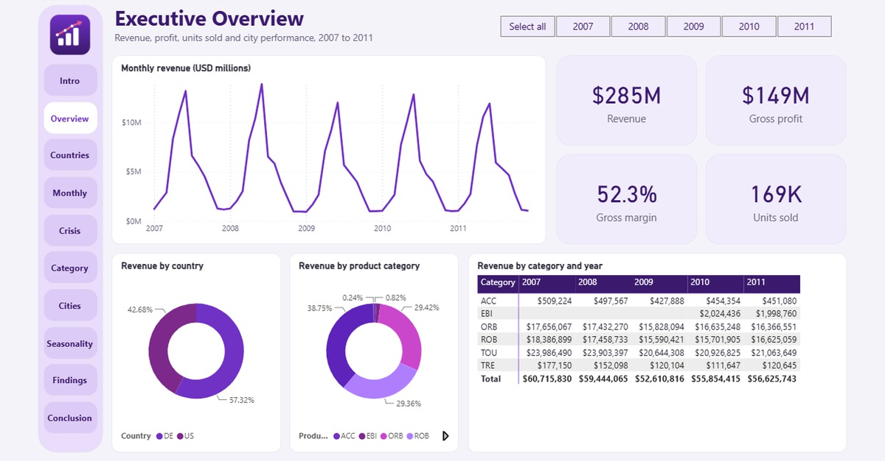

## Quick links

- 📊 [Power BI project](powerbi/Palmpay%20Sales.pbip) (open in Power BI Desktop)
- 📄 [Strategic brief (PDF)](docs/Palmpay-Strategic-Brief.pdf), which renders inline on GitHub
- 🎞️ [Presentation (PowerPoint)](docs/Palmpay-Presentation.pptx) with the speech in the slide notes
- 🎤 [Speech and likely questions](docs/Speech.md)

---

> **A note on GitHub previews.** GitHub renders Markdown, PDFs and images inline. It does not preview PowerPoint files or Power BI projects in the browser. For those, GitHub shows a file page with a **Download** button on the top right. This is normal.

---

## Table of Contents

- [About the project](#about-the-project)
- [Headline findings](#headline-findings)
- [Report pages](#report-pages)
- [Repository structure](#repository-structure)
- [Data](#data)
- [Run it locally](#run-it-locally)
- [Key insights](#key-insights)
- [Recommendations](#recommendations)
- [Tech stack](#tech-stack)
- [Limitations](#limitations)
- [License](#license)

---

## About the project

I first answered this assessment in October 2025. This repository holds the rebuild I made in October 2026, after studying Power BI and Fabric. It is a 12-page report in the Power BI Project (.pbip) format, so every page, measure and relationship is readable as text. The 2025 files are not included.

The work covers the full BI cycle:

1. **Modelling** one sales table with a date table and a field parameter for the metric switcher
2. **Measuring** revenue, gross profit, margin, year-on-year change and off-road share in DAX, with measures that also build every chart title
3. **Visualising** the results in a 12-page report with KPI sparklines, drill-through pages and a Play Axis
4. **Presenting** the findings in an 11-slide deck, a strategic brief and a speech

---

## Headline findings

| Metric | Value | Note |
|---|---|---|
| Revenue | **$285M** | About 169,000 items sold over five years |
| Gross profit | **$149M** | A margin of 52.3% |
| Germany | **$31.0M to $35.1M** | Grew every year |
| United States | **-26% in 2009** | $28.0M in 2008, $20.8M in 2009, near $21.5M since |
| Worst month | **-24.2%** | January 2009 against a year earlier (excluding Silicon Valley Bikes) |
| Top category | **Touring bikes** | 37 to 40% of revenue in every year |
| The flop | **Fixed Gear Bike Plus** | 72 units in five years |
| Spring share | **54%** | Of revenue arrives in April to June |

---

## Report pages

Click any image to view full size.

### 1. Introduction

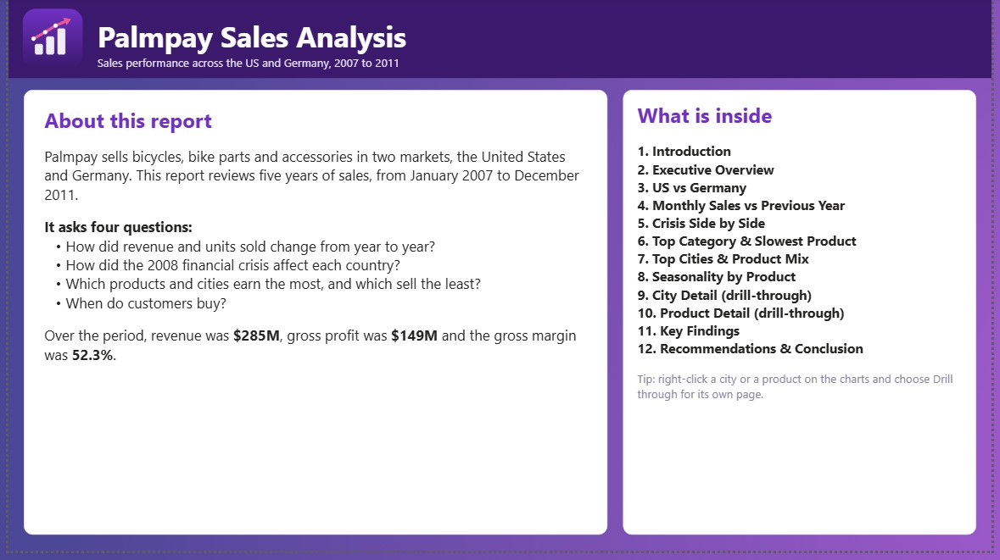

### 2. Executive overview

*Revenue, gross profit, margin and units on one page. Year buttons filter every visual. A navigation rail on the left links to every page of the report and highlights the page you are on.*

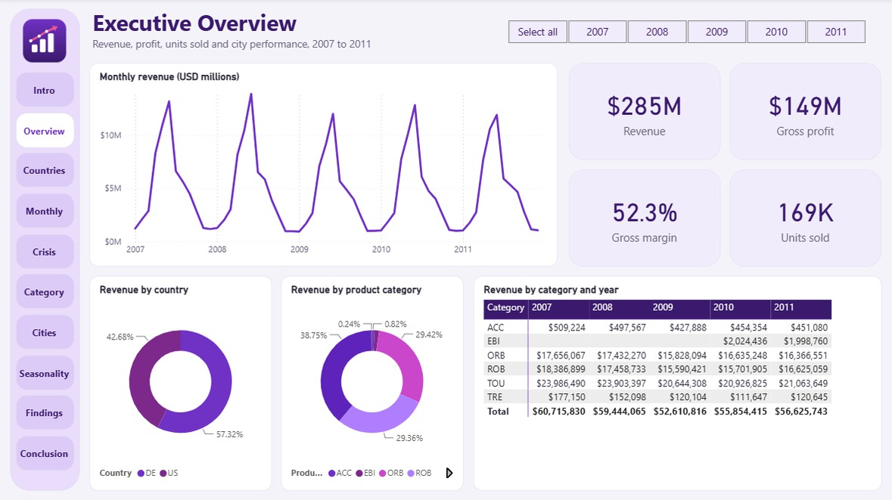

### 3. US vs Germany

*Revenue, units and discount by country.*

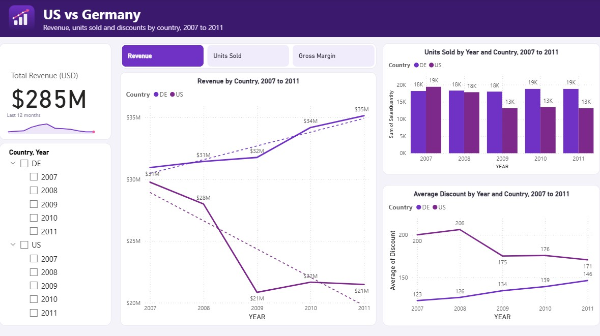

### 4. Monthly sales against the previous year

*Year-on-year change by month, with anomaly detection.*

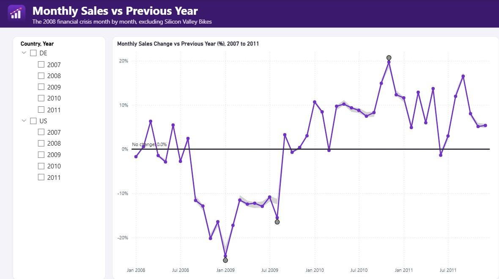

### 5. The crisis side by side

*Small multiples compare the two countries through 2008 and 2009.*

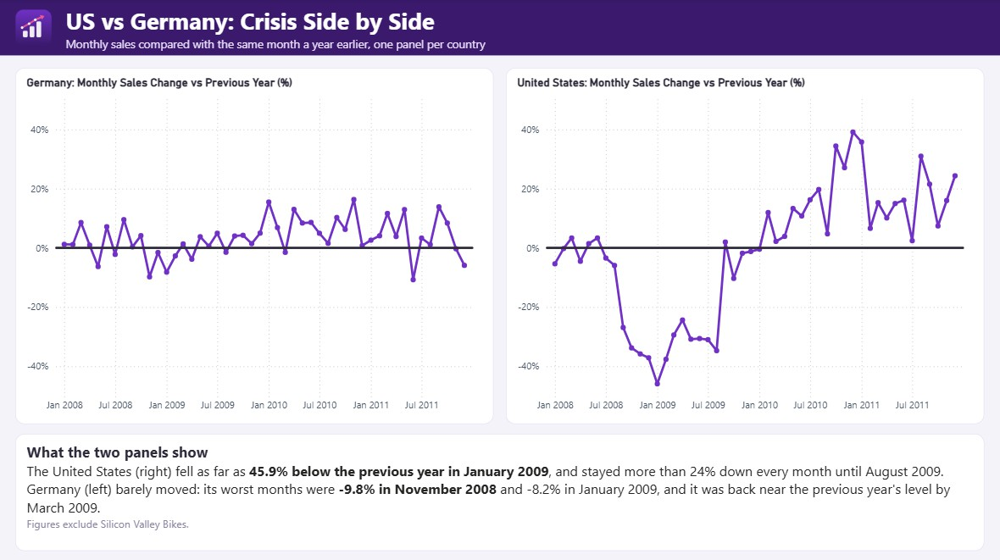

### 6. Top category and slowest product

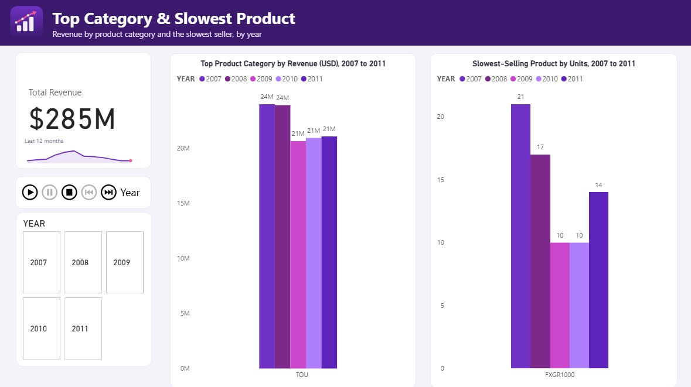

### 7. Top cities and product mix

*Off-road share of bicycle units by city.*

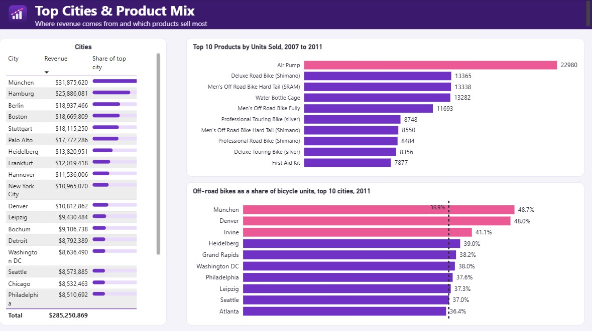

### 8. Seasonality by product

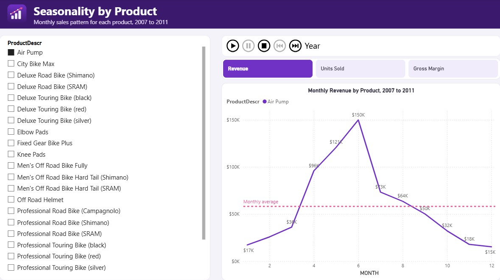

### 9. City detail (drill-through)

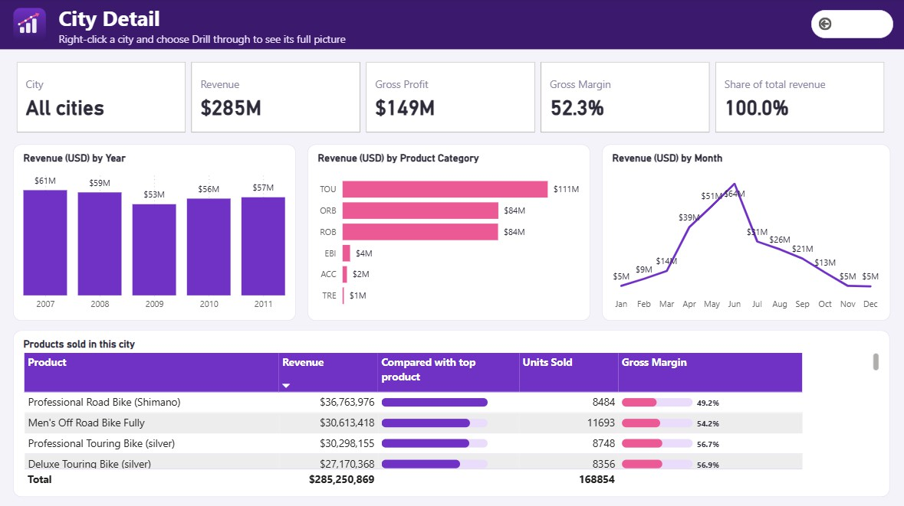

### 10. Product detail (drill-through)

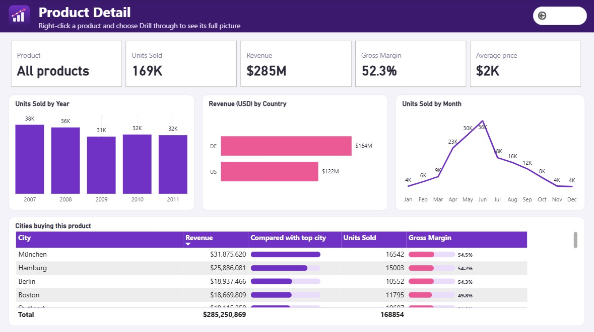

### 11. Key findings

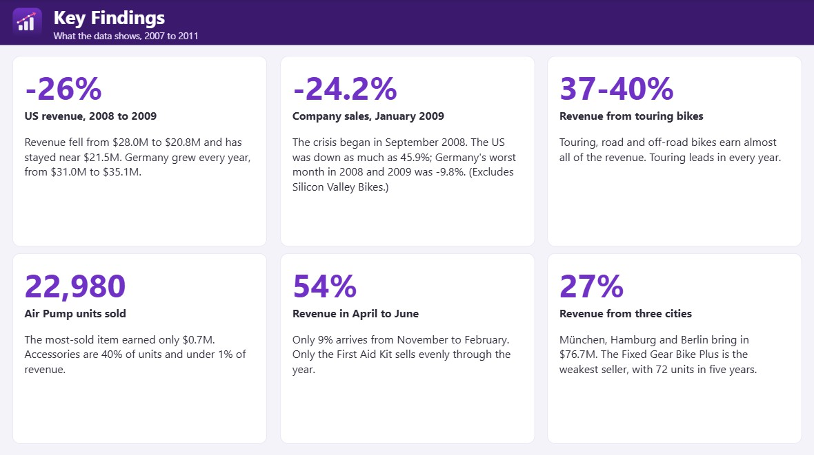

### 12. Recommendations and conclusion

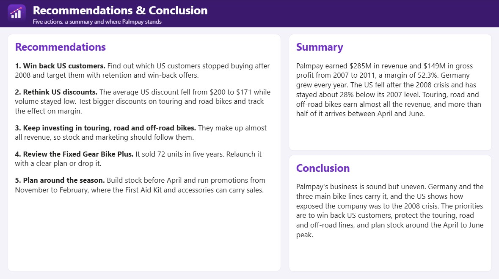

For the story behind each page, see [the strategic brief](docs/Palmpay-Strategic-Brief.pdf).

---

## Repository structure

```
palmpay-bi-assessment/
│
├── README.md                              This file
├── LICENSE                                MIT
├── CONTRIBUTING.md                        Contribution guidelines
├── .gitignore
│
├── docs/
│   ├── Palmpay-Strategic-Brief.pdf        Renders inline on GitHub
│   ├── Palmpay-Presentation.pptx          11 slides, speech in the notes
│   ├── Speech.md                          The speech and likely questions
│   ├── logo.png
│   └── screenshots/                       Report page JPGs and hero image
│
└── powerbi/
    ├── Palmpay Sales.pbip                 Open this in Power BI Desktop
    ├── Palmpay Sales.Report/              Pages and visuals as readable JSON
    └── Palmpay Sales.SemanticModel/       Tables, columns and measures as TMDL
```

---

## Data

The sales data is not included, because the Excel workbook belongs to the assessment. The model has one sales table, a date table and a small table that drives the metric switcher.

| Column | Description |
|---|---|
| `YEAR`, `MONTH`, `DAY` | Date of the order line |
| `Customer`, `CustomerDescr` | Customer code and name |
| `City`, `Country`, `Salesorg` | Where the sale was made |
| `OrderNumber`, `OrderItem` | The order and the line within it |
| `Product`, `ProductDescr` | Product code and name |
| `Product Category`, `Division` | The product group, such as touring bikes |
| `SalesQuantity`, `UnitOfMeasure` | Units sold |
| `Revenue` | Revenue in the sales currency |
| `Revenue USD`, `Cogm USD` | Revenue and cost of goods manufactured in US dollars |

All figures in the report use the US dollar columns, because the sheet records sales in more than one currency.

---

## Run it locally

1. Clone or download this repository.
2. Open `powerbi/Palmpay Sales.pbip` in Power BI Desktop (free from Microsoft).
3. The Play Axis visual comes from AppSource and installs the first time Power BI asks for it.
4. The model reads its sales from a `DataFile` setting, because the assessment workbook is not in this repository. Choose Home, Transform data, Edit parameters, and set `DataFile` to the full path of your copy of the workbook (it needs a sheet called `Sales`). Then choose Refresh.
5. If every visual is blank, the model has no data yet. This is almost always a wrong `DataFile` path.

---

## Key insights

1. **Germany grew every year and the US did not.** Germany went from $31.0M to $35.1M. The US fell from $28.0M in 2008 to $20.8M in 2009 and has stayed near $21.5M since.

2. **The 2008 crisis hit the US hardest.** All sales were 24.2% below the year before in January 2009. The US fell as far as 45.9%, while Germany's worst month across 2008 and 2009 was -9.8%.

3. **Touring bikes lead every year.** They bring in 37 to 40% of revenue, $21M to $24M a year.

4. **One product is a flop.** Fixed Gear Bike Plus sold 21, 17, 10, 10 and 14 units a year, 72 in total.

5. **Off-road bikes are 37.5% of 2011 bicycle units.** München (48.7%), Denver (48.0%) and Irvine (41.1%) are the highest.

6. **Spring is the season.** 54% of revenue arrives in April to June, and 9% from November to February. The First Aid Kit is the one product without a season.

---

## Recommendations

| Priority | Action | Expected impact |
|---|---|---|
| High | Win back US customers: find who stopped buying after 2008 and target them with win-back offers | US revenue is about $8M a year below 2007, the largest gap in the business |
| High | Rethink US discounts: test bigger discounts on touring and road bikes and track the effect on margin | The US cut its discount and volume did not come back |
| Medium | Keep investing in touring, road and off-road bikes | They make up almost all revenue |
| Medium | Review the Fixed Gear Bike Plus | Either needs a plan or should be dropped |
| Medium | Plan stock and promotions around the season | Build stock before April and run promotions from November to February |

Full discussion in [the strategic brief](docs/Palmpay-Strategic-Brief.pdf) and [the speech](docs/Speech.md).

---

## Tech stack

| Layer | Tool |
|---|---|
| Data preparation | Excel, Power Query |
| Modelling and measures | Power BI, DAX, field parameters |
| Visualisation | Power BI Desktop, Play Axis custom visual |
| Documentation | PowerPoint, PDF |

---

## Limitations

- **Five years and two countries, ending in 2011.** More recent figures would be needed before committing budget.
- **No reasons.** The data shows what happened, not why customers behaved as they did.
- **The discount trend proves nothing.** The US cut its discount while volume stayed low, and Germany raised its discount while it grew. Discounts would need testing.
- **Silicon Valley Bikes is excluded from the crisis question only.** The assessment asked for that exclusion in question A3. Every other figure includes all customers.
- **The data is not published.** The workbook belongs to the assessment, so the project can't be refreshed without your own copy.

---

## License

Released under the MIT License. See [LICENSE](LICENSE).

---

**Built by Bih Brandy Sango** · Data Scientist and BI Analyst

- 📊 [Power BI project](powerbi/Palmpay%20Sales.pbip)
- 📄 [Strategic brief](docs/Palmpay-Strategic-Brief.pdf)
- 🎞️ [Presentation](docs/Palmpay-Presentation.pptx)
